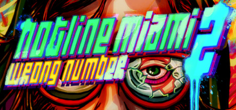

**Hotline Miami 2: Wrong Number expands the original's story across multiple perspectives including a movie being made about the first game's events. Features larger levels, more characters, and an even more complex and deliberately confusing narrative.**

---

## 📖 About

Hotline Miami 2: Wrong Number expands the original's story across multiple perspectives including a movie being made about the first game's events. Features larger levels, more characters, and an even more complex and deliberately confusing narrative.

## ⚠️ Problems Without Trainer

| Problem | Status |
|---------|--------|
| **Larger Level Size** — Bigger maps make planning ahead and memorizing layouts more complex | ✅ Solved |
| **Enemy Gun Variety** — More firearm-using enemies punish aggressive rushing more than original | ✅ Solved |
| **Jake Chapter** — Some player characters have no executions, creating different challenge profiles | ✅ Solved |
| **True Ending** — Unlocking all secrets for complete narrative context requires thorough exploration | ✅ Solved |

## ✅ Solution

The **Hotline Miami 2: Wrong Number Trainer** solves all these issues by giving you complete control over the game.

## 🎯 Full Feature List

- Unlimited Resources
- God Mode / Invincibility
- Instant Skill Cooldown
- One-Hit Kill
- Freeze Game Timer
- Unlock All Items & Achievements
- Custom Speed Multiplier
- Save State Anywhere

## 🚀 Quick Start

1. **Disable Windows Defender** temporarily (trainer may trigger false positive)
2. Download the trainer from the button above
3. Launch Hotline Miami 2: Wrong Number
4. Run the trainer as Administrator
5. Activate desired cheats with hotkeys

## 💎 Free vs Paid

| Feature | Free | Pro |
|---------|------|-----|
| Basic God Mode | ✅ | ✅ |
| Unlimited Resources | ✅ | ✅ |
| All Advanced Cheats | ❌ | ✅ |
| Auto-Updates | ❌ | ✅ |
| Priority Support | ❌ | ✅ |

## 💻 Requirements

- Windows 10/11 (64-bit)
- Hotline Miami 2: Wrong Number (any version)
- .NET Framework 4.8+
- DirectX 11+

## 🍎 macOS

macOS users can use our alternative tool:

## ⚖️ Legal

This trainer is for educational and single-player use only. Use responsibly.

---

